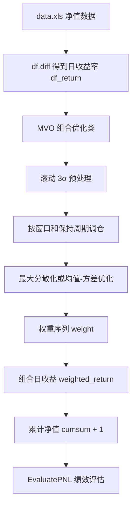

# `algo.py` 分析

`algo.py` 的整体功能是：读取多个子策略的净值数据，先计算日收益率，再通过 `MVO` 类在“回看窗口 + 保持周期”的滚动框架下动态分配子策略权重，最后用 `EvaluatePNL` 类评估组合的年化收益、波动率、夏普比率、最大回撤、胜率和 Calmar 比率。

从文件结构看，`algo.py` 可以分成以下几部分：

1. **依赖导入与警告屏蔽**：导入 `pandas`、`numpy`、`scipy.optimize.minimize`，并用 `warnings.filterwarnings('ignore')` 全局忽略警告。
2. **绩效评估模块**：`EvaluatePNL` 类，负责把一条净值曲线转换成多种绩效指标。
3. **极值预处理函数**：顶层 `norm_preprocess`，用滚动窗口做 3σ 盖帽。
4. **组合优化模块**：`MVO` 类，包含约束构建、最大分散化权重、均值-方差权重、滚动权重生成和运行入口。
5. **脚本入口**：`if __name__ == "__main__":` 下读取 `data.xls`，构造不同参数组合，循环回测并打印指标。

可以用下面的 Mermaid 图理解数据流：

阅读示例数据时要注意：`data.xls` 的 Sheet1 中，第一列是日期，`a` 到 `h` 是 8 个子策略的净值序列。2020-12-22 全部为 1，之后发生变动。Sheet2 和 Sheet3 是空表。代码中的 `df.diff(1).fillna(0)` 就是把净值差分得到日收益，首日收益补 0。

---

## 分模块讲解

### 1. 顶层函数 `norm_preprocess`

**一句话职责**：对收益率矩阵做滚动 3σ 极值盖帽，把异常大或异常小的收益率拉回到滚动均值的 ±3 倍标准差范围内。

**关键技术点**：

- 滚动极值处理：避免单日异常收益对协方差和均值造成过大影响。
- 3σ 盖帽：不是删除异常值，而是“缩尾处理”，保留样本数量。
- 切片 `(i-window):i` 不包含当前行，避免用当前值估计当前值的边界。

---

### 2. `EvaluatePNL` 类方法

#### `EvaluatePNL.__init__`

**一句话职责**：初始化绩效评估对象，保存待评估的净值序列和年化交易日数量。

**关键技术点**：

- 把年化天数做成参数，而不是硬编码，方便在“交易日年化”和“自然日年化”之间切换。
- `pnl=None` 是默认值，但如果后续不传 `pnl` 就调用 `test_pipline`，会报错。因此它更像“必须先赋值”的属性。

---

#### `EvaluatePNL.get_return`

**一句话职责**：根据净值曲线计算年化收益。

**关键技术点**：

- 这里用的是“算术平均日收益 × 年化天数”，不是几何年化收益。
- 过滤 0 收益会改变样本集合。如果很多天收益为 0，年化收益可能被高估或低估。
- 如果 `df_pnl` 本身就是日收益序列而不是净值，差分就会变成“收益的变化”，含义会变。因此调用时要确认传入的是净值曲线。

---

#### `EvaluatePNL.get_std`

**一句话职责**：根据净值曲线计算年化波动率。

**关键技术点**：

- 波动率年化通常用 `日波动率 × sqrt(250)`，这里符合这个公式。
- 但过滤 0 收益后，样本不再是完整日序列，标准差估计可能偏差。
- 如果 `tmp_return` 为空或只有一个非零值，`std()` 可能为 `NaN`。

---

#### `EvaluatePNL.get_sharp`

**一句话职责**：计算夏普比率，即年化收益除以年化波动率。

**关键技术点**：

- 这里没有无风险利率，所以是“收益/波动”的简化夏普。
- 如果 `std == 0`，会得到 `inf` 或 `NaN`，代码没有保护。

---

#### `EvaluatePNL.get_max_drawdown`

**一句话职责**：计算最大回撤幅度，并可返回回撤起止日期。

**关键技术点**：

- 这是一种“暴力枚举所有高低点组合”的最大回撤算法，直观但效率低。
- 返回的是正数回撤幅度，而不是负数收益率。
- 如果净值单调上涨，最大 `diff` 可能仍是负数，此时 `max_drawdown` 为负，Calmar 会受到影响。
- 大样本下 `O(n^2)` 内存和时间可能不可接受。

---

#### `EvaluatePNL.get_win_percent`

**一句话职责**：计算日收益胜率，即非零日收益中上涨日的比例。

**关键技术点**：

- 胜率只统计非零收益日，相当于忽略“没有变化”的日期。
- 如果所有日收益都为 0，分母为 0，会触发除零错误或得到 `NaN`。

---

#### `EvaluatePNL.get_calmar`

**一句话职责**：计算 Calmar 比率，衡量单位最大回撤对应的收益。

**关键技术点**：

- 标准 Calmar 通常是“年化收益 / 最大回撤”。这里用“总收益 / (年数 × 最大回撤)”，数学上近似年化收益/最大回撤。
- 如果 `max_drawdown == 0` 或 `yrs == 0`，会除零。
- 如果最大回撤返回负数，Calmar 符号会异常。

---

#### `EvaluatePNL.test_pipline`

**一句话职责**：一次性计算并打印核心绩效指标。

**关键技术点**：

- `@property` 让调用更像“读取一个计算结果属性”，但实际每次访问都会重新计算。
- 如果 `self.pnl` 没有在 `__init__` 中传入，访问该属性会报错。
- 指标打印使用 `&` 分隔，适合复制到表格。

---

### 3. `MVO` 类方法

#### `MVO.__init__`

**一句话职责**：初始化组合优化器，保存收益率数据、回看窗口、保持周期、初始权重、风险厌恶系数和是否使用指数加权。

**关键技术点**：

- 用 `risk_averse is not None` 来切换优化目标，是一种简单的“策略开关”。
- `ewm` 命名不够直观，实际是“是否使用指数加权”的布尔标志。
- `init_weight` 没有默认生成逻辑，若为 `None` 后续广播会出错。

---

#### `MVO.norm_preprocess`

**一句话职责**：与顶层 `norm_preprocess` 功能相同，对收益率矩阵做滚动 3σ 极值盖帽。

**关键技术点**：

- 这是重复代码。顶层函数已经存在，类内又实现了一份。重复代码会增加维护成本。
- 类内方法使用 `self.window` 调用时，参数 `window` 仍然需要传入，容易混淆。

---

#### `MVO.get_constrain`

**一句话职责**：根据上一期权重生成 `scipy.optimize.minimize` 需要的约束条件。

**关键技术点**：

- `scipy.optimize.minimize` 的约束用字典表示，`type='eq'` 表示等于 0，`type='ineq'` 表示大于等于 0。
- 约束硬编码了 8 个资产，一旦资产数量变化就会出错。
- 换手约束可能让优化问题不可行，尤其是初始权重与目标差异很大时。
- 没有检查 `res.success`，优化失败时仍会使用 `res.x`。

---

#### `MVO.get_daily_div_weight`

**一句话职责**：根据过去一段收益率序列，计算“最大分散化”组合权重。

**关键技术点**：

- 最大分散化组合的目标是让组合波动尽量低，同时保留各资产的平均波动贡献。
- `ewm` 分支中 `std = np.diagonal(cov)` 得到方差，而普通分支得到标准差，量纲不一致。这是一个潜在 bug。
- `res.x` 可能不是全局最优，也可能因约束不可行而失败。代码没有检查 `res.success`。

---

#### `MVO.get_daily_mvo_weight`

**一句话职责**：根据过去一段收益率序列，计算均值-方差优化组合权重。

**关键技术点**：

- `risk_averse` 越大，风险惩罚越强，权重越偏向低波动组合。
- 当 `risk_averse=0` 时，目标退化为最大化预期收益，可能集中到高收益资产，但受约束限制。
- 与最大分散化一样，没有检查优化是否成功。

---

#### `MVO.get_weight`

**一句话职责**：在时间轴上滚动生成每日子策略权重序列。

**逐段逻辑拆解**：

1. `df_weight = pd.DataFrame(1., index=self.df_return.index, columns=self.df_return.columns)`  
   创建与收益率矩阵同形状的权重 DataFrame，初始全为 1。

2. `df_weight = df_weight * self.init_weight`  
   按列乘以初始权重。由于 `init_weight` 是长度等于列数的数组，会广播到每一行。

3. `processed_return = self.norm_preprocess(self.df_return, window=self.window, n_sigma=3)`  
   对收益率做 3σ 预处理。

4. `for i in range(len(self.df_return)):`  
   逐日遍历。

5. `if i >= self.window:`  
   前 `window` 天不调仓，保持初始权重。

6. `if (i - self.window) % self.keep == 0:`  
   每隔 `keep` 天调仓一次。

7. `w_return = processed_return.iloc[(i-self.window):i]`  
   取过去 `window` 天的收益率，不包含当前日。

8. `w_return = w_return.rolling(self.keep).sum().dropna()`  
   对过去 `window` 天做滚动 `keep` 日求和，得到若干调仓周期收益。

9. `if self.risk_averse is not None:`  
   如果设置了风险厌恶系数，使用均值-方差优化。

10. `daily_weight = self.get_daily_mvo_weight(w_return, df_weight.iloc[i-1])`  
    计算 MVO 权重。

11. `else:`  
    否则使用最大分散化。

12. `daily_weight = self.get_daily_div_weight(w_return, df_weight.iloc[i-1])`  
    计算最大分散化权重。

13. `df_weight.iloc[i] = daily_weight`  
    写入当日权重。

14. `else:`  
    如果不到调仓日。

15. `df_weight.iloc[i] = df_weight.iloc[i-1]`  
    延续前一日权重。

16. `return df_weight`  
    返回完整权重序列。

**关键技术点**：

- “回看窗口 + 保持周期”是常见的滚动优化框架。
- 调仓日才优化，非调仓日复制前一日权重，降低换手和计算量。
- 权重初始化通过 DataFrame 广播实现，依赖列顺序与 `init_weight` 顺序一致。
- 没有考虑交易成本、滑点、权重漂移和再平衡成本。

---

#### `MVO.run`

**一句话职责**：执行权重优化，并计算组合日收益。

**逐段逻辑拆解**：

1. `@property`  
   把 `run` 变成属性，访问 `portfolio.run` 时自动执行。

2. `self.weight = self.get_weight()`  
   调用 `get_weight` 得到权重序列。

3. `self.weighted_return = (self.weight * self.df_return).sum(axis=1)`  
   权重矩阵与日收益矩阵逐元素相乘，再按行求和，得到组合日收益。

**关键技术点**：

- 组合日收益按“当日权重 × 当日各资产收益”计算，这是一种简化回测。
- 没有考虑权重因资产涨跌自然漂移，因此更接近“每日再平衡到目标权重”的假设。
- `@property` 让调用简洁，但也会隐藏计算成本。

---

## 逐类讲解

### `EvaluatePNL` 类

**类的职责与设计意图**：  
`EvaluatePNL` 把一条净值曲线作为输入，封装成一组绩效指标计算函数。它的设计意图是让调用者只需要传入 `pnl`，然后通过 `test_pipline` 一次性打印所有指标。

---

### `MVO` 类

**类的职责与设计意图**：  
`MVO` 负责在多个子策略之间动态分配权重。它支持两种优化目标：

1. 最大分散化：`risk_averse is None`。
2. 均值-方差优化：`risk_averse is not None`。

同时支持普通协方差和指数加权协方差。

---

## 总结

`algo.py` 是一个“组合优化 + 绩效评估”的示例脚本。它的核心逻辑是：

1. 从 `data.xls` 读取 8 个子策略净值。
2. 差分得到日收益率。
3. 用 `MVO` 类在滚动窗口内做 3σ 预处理。
4. 每隔 `keep` 天，用最大分散化或均值-方差优化重新分配权重。
5. 计算组合日收益，并累计成净值曲线。
6. 用 `EvaluatePNL` 打印年化收益、波动率、夏普、Calmar、胜率和最大回撤。
